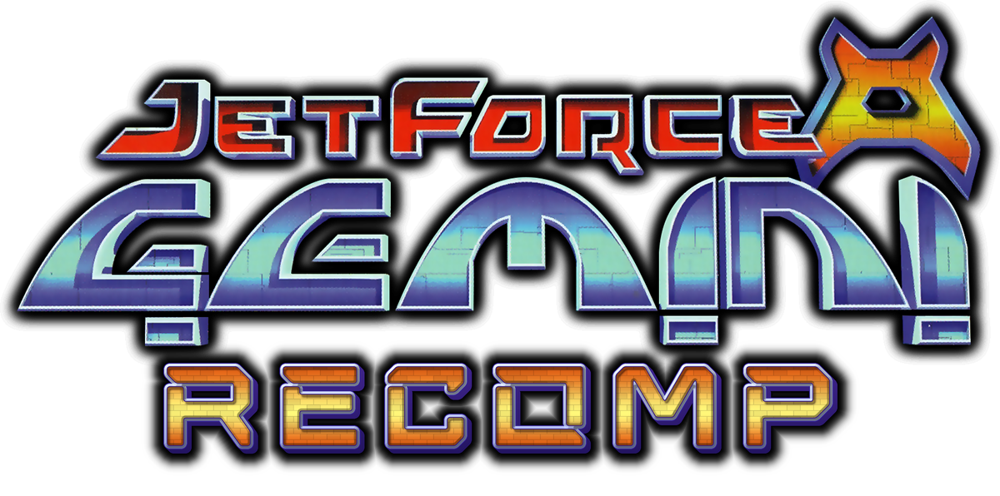

A native 100% playable PC port of Jet Force Gemini (N64, US) for Windows and Linux, made by static recompilation. No emulator:
the game's code is translated from your ROM and compiled for your PC.

**Current Progress:** Quality of Life features & Mod support.

**No game code or assets are included.** You need your own ROM.

## ROM

Jet Force Gemini **US**, `.z64` format, SHA-1 `493ced9008dbe932d6e91179b68e8630cf23a023`.

## Features

**Controls**
- Mouse and keyboard controls.
- Dual-stick controls with a camera-relative left stick and a modern button layout.
- Over-the-shoulder aim with a centred reticle, and adjustable aim speed.
- Adjustable movement speed
- Rumble Pak support, and rebindable controls.

**Gameplay**
- Skips cutscenes
- A Weapons editor for each weapon
- No blood option.
- Cheats (Skip Tribals yay!)

**Visuals**
- 60 FPS
- HD Texture Pack
- Widescreen.
- Ambient occlusion (SSAO) and bloom.
- Disable LOD and draw distant objects.
- Fly camera for screenshots (F7).
- On-screen FPS, level and texture pack.

**Texture packs**
- The JFG HD texture pack is a separate download. See
  [vibintoast.com/projects/jfg-4k](https://vibintoast.com/projects/jfg-4k) for more info.
- Texture dumping, all in one folder or one folder per level.
- HD texture packs, picked from a list and switched in-game with F6. A pack is a folder in `bin/texture_packs/<name>`
  or a packed `.rtz` file (a zip with `rt64.json` at its root) in `bin/texture_packs/`.
- A `.rtz` pack can also go in `bin/mods/`. It is then loaded as a mod, turned on by default, and can be switched
  on and off and reordered in the Mods tab of the settings menu (Select / Esc).

- To make your own texture pack, see [docs/TEXTURE_PACKS.md](docs/TEXTURE_PACKS.md).

**Tools (F10 toolbar)**
- Cheats: invulnerable, unlimited ammo, all weapons, all levels, skip the Tribal check.
- Level warp to any level, with a choice of character and entrance.
- Items editor: weapons, ammo, health, keys, objects, Tribals, ship and Floyd parts, progress flags and
  multiplayer unlocks.
- Quick profile and texture-pack switching.

## Build and run

(Making a release instead: see [docs/RELEASING.md](docs/RELEASING.md).)

 Save your rom as
`baserom.us.z64` in this folder.

**Windows** (10/11, Direct3D 12 GPU): install Visual Studio 2022 (Desktop development with C++, plus C++ Clang
tools), Git and Python 3. Run `build_windows.bat` (the first build takes 10-40 minutes, about 15 GB), then
`run_windows.bat`.

**Linux** (Vulkan GPU):

```
sudo apt install git cmake ninja-build clang lld python3 libsdl2-dev libvulkan-dev libgtk-3-dev libdbus-1-dev libfreetype6-dev
./build_linux.sh && ./run_linux.sh
```

The game ends up in `bin`, together with its saves and settings. The build also creates empty `bin/mods` and `bin/texture_packs` folders for mods and texture packs (see
[docs/TEXTURE_PACKS.md](docs/TEXTURE_PACKS.md)); anything already in them is kept. The build itself happens in this folder
(`lib`, `build-tools`, `build-windows` / `build-linux`, `RecompiledFuncs`), none of which is committed.
Keep `bin` private, because it holds a copy of the ROM.

## Keys

| Key | Action |
|---|---|
| Select / Esc | Settings menu |
| F10 | Tools toolbar (Alt switches between the toolbar and the game) |
| F9 | Debug window |
| F5 / F6 | Back to the title screen / next texture pack |
| F7 | Fly camera |
| F11 / Alt+Enter | Fullscreen |

## Reporting bugs

Report bugs on the [Issues page](https://github.com/VibinToast/JetForceGemini-Recomp/issues). Check first whether it
is already reported there or listed in [KnownIssues.md](KnownIssues.md).

Please include:
- **What happened and what you expected.** Steps to make it happen again, if you know them.
- **Where.** The level and roughly where in it (Settings > Visuals > Show Level puts the level on screen), or the
  menu or cutscene.
- **Your setup.** The release version or commit, Windows or Linux, your GPU, and your monitor's refresh rate.
- **Your settings**, if they could matter: the profile, Frame Rate, Widescreen, and the Graphics menu's Framerate.
  `jfg_port_options.txt` and `graphics.json` from the `bin` folder hold them.
- **A screenshot or video**, for anything visual.
- **Logs**, if the game crashed or stopped with an error: `crash.log`, `jfg_error.log` and `jfg_memory.log` from the
  `bin` folder, whichever exist.

Do not attach your ROM, or anything else from `bin` beyond the files above.

## How it works

The port uses [N64Recomp](https://github.com/N64Recomp/N64Recomp) to translate the game's code (configured by
`jfg.us.toml` and the symbol files in `JFGRecompSyms`, a submodule mods use too),
[N64ModernRuntime](https://github.com/N64Recomp/N64ModernRuntime) in place
of the N64 operating system, and [RT64](https://github.com/rt64/rt64) for rendering. It is built on
[cyscott/dkr-recomp](https://github.com/cyscott/dkr-recomp), whose history is merged into this repository: its files
are edited here directly. The port's own code is in `src/jfg/`.

N64Recomp, N64ModernRuntime and RT64 (and RT64's plume) are git submodules in `lib/`, each pointing at the port's
fork on its `jfg` branch: the base project's fixes and the port's own changes are commits there. To change one,
commit on that fork's `jfg` branch and commit the new submodule commit here; the build scripts check out the
commits this repository pins (set `JFG_KEEP_LIBS=1` to build with `lib/` as it is).

The symbol files are the `JFGRecompSyms` submodule at the root, pinned the same way. To update them, regenerate them
from a decomp build with `tools/gen_reference_syms.py`, commit them in JFGRecompSyms, then commit the new submodule
commit here.

## AI disclosure

This project was built with heavy help from AI (Claude), under the direction of the project owner. It has not had
an independent code review.

## Legal

Jet Force Gemini and its logos belong to their rights holders. This project is not affiliated with or endorsed by
them. Do not share the ROM or anything generated from it. The code is licensed under GPL v3 (see `LICENSE`).

## Credits

- The Jet Force Gemini decompilation project
- cyscott/dkr-recomp and the Diddy Kong Racing decompilation
- N64Recomp, N64ModernRuntime, RT64 and their contributors
