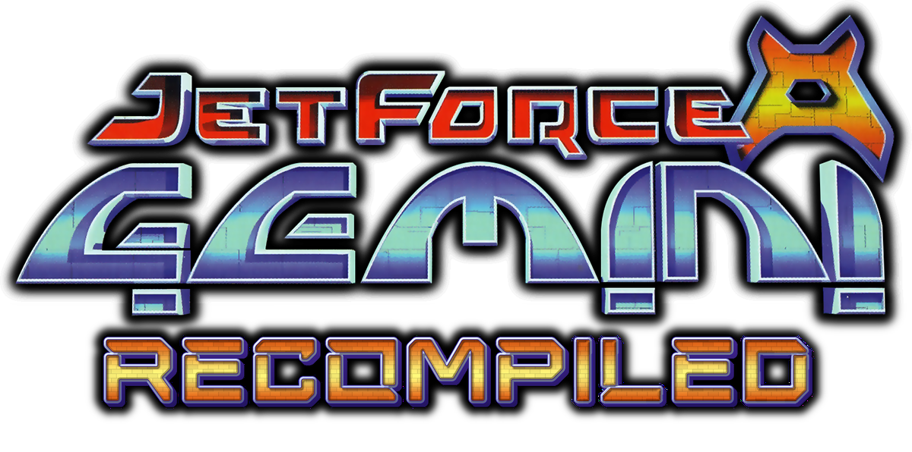
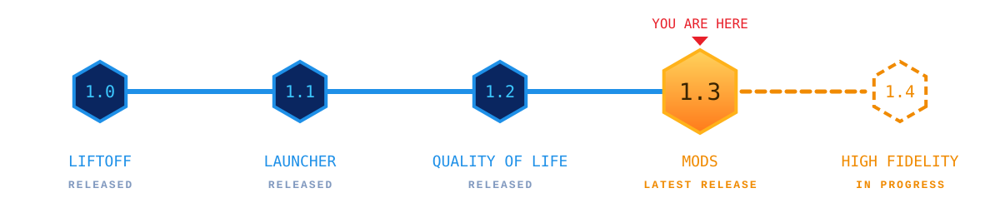
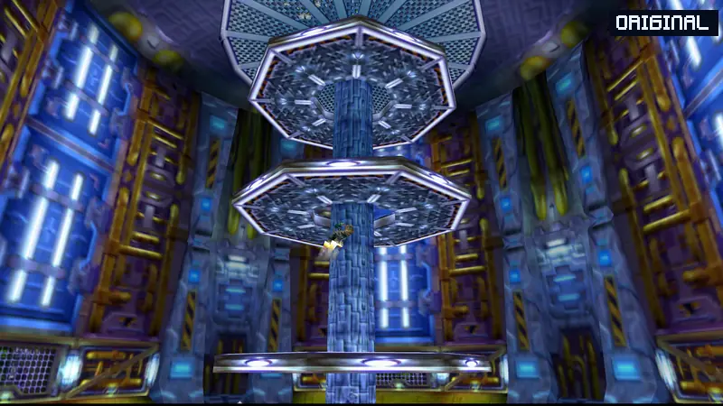
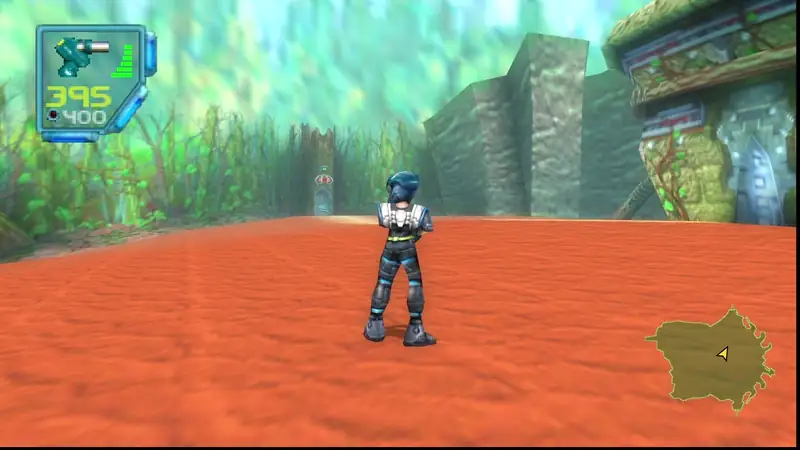
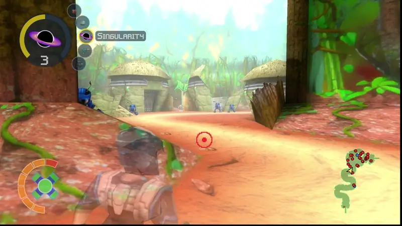
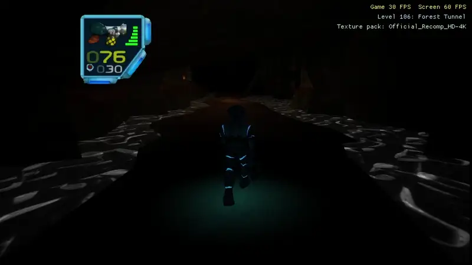

Playable PC port of Jet Force Gemini (N64, US) for Windows Linux, & Steam Deck, made by static recompilation. No emulator:
the game's code is translated from your ROM and compiled for your PC. <br><br>

**Roadmap:**

[](ROADMAP.md)

**Linux players on 1.2.x:** download this release by hand once. The repository was renamed and the old update check can't see the new name; from 1.3 on, it works as usual.

**No game code or assets are included.** You need your own ROM.

**Contents:** [ROM](#rom) · [Features](#features) · [Modding](#modding) · [Steam Deck](#steam-deck) · [Keys](#keys) ·
[Build from source](#build-from-source-and-run) · [Reporting bugs](#reporting-bugs) · [How it works](#how-it-works) ·
[AI disclosure](#ai-disclosure) · [Legal](#legal) · [Credits](#credits) · [Roadmap](ROADMAP.md) · [Known issues](KNOWN_ISSUES.md)

## ROM

Jet Force Gemini **US**, `.z64` format, SHA-1 `493ced9008dbe932d6e91179b68e8630cf23a023`.

## Features

<table>
<tr>
<td width="50%" valign="top"><br>
<b>4K textures</b><br>
The official HD texture pack: every texture upscaled to up to 4K. It installs and updates from the launcher, and
switches in-game with F6. Get it at
<a href="https://github.com/VibinToast/JetForceGemini-HD_TexturePack">JetForceGemini-HD_TexturePack</a>
(<a href="https://vibintoast.com/projects/jfg-4k">more about the pack</a>).</td>
<td width="50%" valign="top"><br>
<b>Modern controls</b><br>
Dual-stick or mouse and keyboard, with over-the-shoulder aim and a centered reticle, sprint, and Floyd missions you can fly with the mouse.</td>
</tr>
<tr>
<td width="50%" valign="top"><br>
<b>Modding</b><br>
20+ official mods, one click each in the launcher's Get Mods page: a minimap, new weapons, a dodge, a kill feed,
custom enemies and more (<a href="https://github.com/VibinToast/JFG-Mods">JFG-Mods</a>). Make your own levels, planets
and galaxies with <a href="https://github.com/VibinToast/JFG-Studio">JFG-Studio</a>; see <a href="#modding">Modding</a>.</td>
<td width="50%" valign="top"><br>
<b>Real-time lighting</b> <sup>coming in 1.4</sup><br>
A first look at modern lighting for the next release.</td>
</tr>
</table>

**And more**
- **10+ languages** (English, French, German, Spanish, Japanese, Swedish and more).
- Display frame rate up to 240 Hz, or your monitor's refresh rate, for smoother motion.
- Widescreen, ambient occlusion and bloom, and no LOD pop-in.
- Auto Save, Unlimited Continues, and Tribals that stay rescued.
- Profiles: the original game or a modern setup in one click.
- Full controller support in the menus, launcher and tools; rebindable controls and Rumble Pak.
- Skip cutscenes, gore options and a weapons editor.
- F10 tools: cheats, level warp and an items editor. Fly camera for screenshots (F7).

## Modding

Mods are `.nrm` files in `bin/mods/`, turned on and off and ordered in the **Mods** tab of the settings menu. A mod can
add planets and whole galaxies to the planet map, new levels, reskinned enemies, its own music, Lua scripts and
weapon tuning, change the game's own levels, or patch the game's code.

- **[The JFG Modding Wiki](https://jfg.vibintoast.com)**: how to make mods, with tutorials, the API's status (built,
  partial, planned) and the pack formats.
- **[JFG-Studio](https://github.com/VibinToast/JFG-Studio)**: a level and modpack editor. Place squads, doors, keys,
  pickups and exits on your own geometry, set up planets and galaxies, add triggers, scripts and music, then build the
  pack and play it with one button. It reads your own ROM; nothing from the game is in what it makes.
- **[jfg64](https://github.com/VibinToast/jfg64-blender)**: a Blender add-on for modelling level geometry for Studio.
- Code mods are built with N64Recomp's RecompModTool against the symbols in `JFGRecompSyms`, with the port's API in
  `mod_api/jfg_api.h`.

**Texture packs**
- Texture dumping, all in one folder or one folder per level.
- A pack is a folder in `bin/texture_packs/<name>` or a packed `.rtz` file (a zip with `rt64.json` at its root) in
  `bin/texture_packs/`, picked from a list and switched in-game with F6. A `.rtz` pack can also go in `bin/mods/`: it
  is then loaded as a mod, and can be switched on and off and reordered in the Mods tab of the settings menu.
- To make your own texture pack, see [docs/TEXTURE_PACKS.md](docs/TEXTURE_PACKS.md).
- How the port gives levels and mods more memory than the N64 had: [docs/MEMORY.md](docs/MEMORY.md).

## Steam Deck

Use the Linux AppImage, and always start the game **through Steam**, in Desktop Mode too:

1. In Desktop Mode, make the AppImage executable (right-click it, Properties > Permissions), then add it to Steam
   (right-click > Add to Steam, or "Add a Non-Steam Game" in Steam).
2. Start it from your Steam library, in Game Mode or Desktop Mode.
3. Choose your ROM the first time in Desktop Mode: Game Mode may have no file picker. Or write its path in
   `~/.local/share/JetForceGeminiRecompiled/jfg_launcher.txt` as `rom=/home/deck/path/to/baserom.us.z64`.

Keep **Mouse and Keyboard Controls** (settings menu, **Controls** tab) **Off** on the Deck. The Modern profiles turn
it on, so set it back to Off after choosing one, or turn on **Keep My Controls** (Profiles tab) first.

Why: started from the file manager, Steam turns the Deck's controls into a keyboard and mouse as well as a controller,
so every press counts twice (Start opens the settings menu, and menu moves skip a button). With Mouse and Keyboard
Controls on, the touchscreen and trackpads act as a mouse that aims and fires, and firing can stay stuck after you
close the settings menu.

## Keys

| Key | Action |
|---|---|
| Select / Esc | Settings menu |
| F10 | Tools toolbar (Alt switches between the toolbar and the game) |
| F9 | Debug window |
| F5 / F6 | Back to the title screen / next texture pack |
| F7 | Fly camera |
| F11 / Alt+Enter | Fullscreen |

## Build from source and run

 Save your rom as
`baserom.us.z64` in this folder.

**Windows** (10/11, Direct3D 12 GPU): install Visual Studio 2022 (Desktop development with C++, plus C++ Clang
tools), Git and Python 3. Run `build_windows.bat` (the first build takes 10-40 minutes, about 15 GB), then
`run_windows.bat`.

**Linux** (Vulkan GPU). The release files run on Ubuntu 22.04 or newer, Debian 12 or newer, current Fedora and SteamOS
3: the AppImage (on a Steam Deck: make it executable, then "Add a Non-Steam Game"; saves go to
`~/.local/share/JetForceGeminiRecompiled`) or the portable `.tar.gz` (saves stay in its folder). Older systems
(Ubuntu 20.04, Debian 11) are not supported. The update check and the HD pack download need `curl`, and the Open
Folder buttons need `xdg-open` (xdg-utils).

To build it yourself, install the packages for your system, then run `./build_linux.sh && ./run_linux.sh`. The build
needs clang 15 or newer and a recent CMake, so on Ubuntu 22.04 and Debian 12 use the release files instead (or the
build container, see `tools/package_release.sh`). On SteamOS, use the AppImage.

Ubuntu 24.04 or newer, Debian 13 or newer:
```
sudo apt install git cmake ninja-build clang lld python3 libsdl2-dev libvulkan-dev libgtk-3-dev libdbus-1-dev libfreetype-dev zlib1g curl
```
Fedora:
```
sudo dnf install git cmake ninja-build clang lld python3 SDL2-devel vulkan-loader-devel gtk3-devel dbus-devel freetype-devel libatomic-static zlib curl
```

The game ends up in `bin`, together with its saves and settings. The build also creates empty `bin/mods` and `bin/texture_packs` folders for mods and texture packs (see
[docs/TEXTURE_PACKS.md](docs/TEXTURE_PACKS.md)); anything already in them is kept. The build itself happens in this folder
(`lib`, `build-tools`, `build-windows` / `build-linux`, `RecompiledFuncs`), none of which is committed.
Keep `bin` private, because it holds a copy of the ROM.

## Reporting bugs

Report bugs on the [Issues page](https://github.com/VibinToast/JetForceGemini-Recompiled/issues). Check first whether it
is already reported there or listed in [Known issues](KNOWN_ISSUES.md).

Please include:
- **Your version.** It's shown in the launcher (for example 1.2.1). If you built the game yourself, the commit.
- **What happened and what you expected.** Steps to make it happen again, if you know them.
- **Where.** The level and roughly where in it (turn on **Show Level** in the settings menu's **General** tab to put
  the level number on screen), or the menu or cutscene.
- **Your setup.** Windows, Linux or Steam Deck, your GPU, and your monitor's refresh rate.
- **Your settings**, if they could matter: the profile, **Display Frame Rate** and **Game Frame Rate** (Graphics tab),
  widescreen, and the texture pack, if any.
- **A screenshot or video**, for anything visual.
- **Logs**, if the game crashed or stopped with an error: `crash.log`, `jfg_error.log` and `jfg_memory.log`,
  whichever exist. Settings files help too: `jfg_port_options.txt` and `graphics.json`.

Where those files are:

| Game | Folder |
|---|---|
| Windows zip | next to `JetForceGeminiRecompiled.exe` |
| Linux AppImage and Steam Deck | `~/.local/share/JetForceGeminiRecompiled` |
| Linux portable (tar.gz) | the game folder |
| Built yourself | `bin` |

Do not attach your ROM, or any other file from those folders beyond the ones above.

## How it works

[N64Recomp](https://github.com/N64Recomp/N64Recomp) translates the game's code into C, which is compiled for your PC.
[N64ModernRuntime](https://github.com/N64Recomp/N64ModernRuntime) stands in for the N64's operating system and
[RT64](https://github.com/rt64/rt64) draws the game. The port is built on
[cyscott/dkr-recomp](https://github.com/cyscott/dkr-recomp), and its own code is in `src/jfg/`. The three libraries
are submodules in `lib/` pinned to the port's forks (branch `jfg`).

## AI disclosure

This project is AI-assisted and directed by a software developer who reviews the output and tests it by hand.

## Legal

Jet Force Gemini and its logos belong to their rights holders. This project is not affiliated with or endorsed by
them. Do not share the ROM or anything generated from it. The code is licensed under GPL v3 (see `LICENSE`).

## Credits

- The Jet Force Gemini decompilation project
- cyscott/dkr-recomp and the Diddy Kong Racing decompilation
- N64Recomp, N64ModernRuntime, RT64 and their contributors
